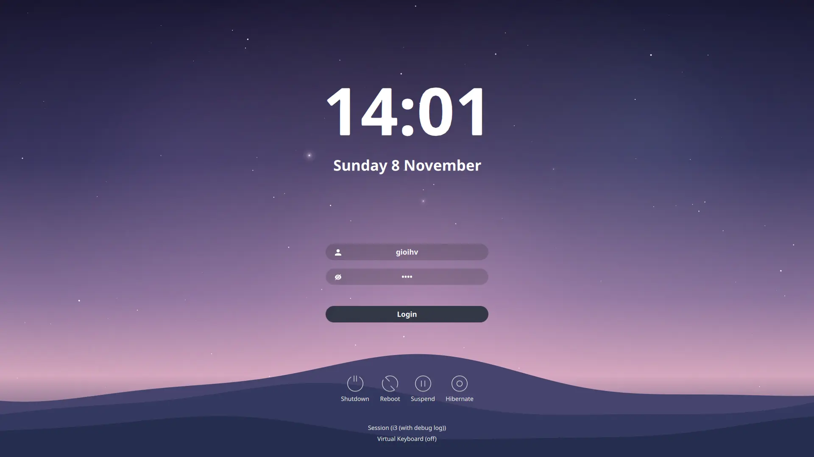

# sddm-arch-mauve

A mauve twilight theme for the SDDM greeter, Qt 6 / SDDM 0.20+.
Forked from [Keyitdev/sddm-astronaut-theme](https://github.com/Keyitdev/sddm-astronaut-theme)
`master` (`abb3163`).



The background is an animated sky drawn in QML Canvas (`Components/MauveSky.qml`):
an indigo → violet → mauve-pink gradient, twinkling stars and four slowly drifting
hill layers. No image or video file, no extra Qt module.

## Install

```bash
git clone https://github.com/hoangvangioi/sddm-arch-mauve.git
cd sddm-arch-mauve
./install.sh                  # asks for sudo; --dry-run to preview, --uninstall to remove
```

It copies the theme to `/usr/share/sddm/themes/sddm-arch-mauve` and sets
`[Theme] Current=sddm-arch-mauve` in `/etc/sddm.conf`, leaving the rest of that file
alone. It never restarts SDDM — that ends your session — so apply it yourself:

```bash
systemctl restart sddm
```

Packages: `sddm`, `qt6-declarative` (≥ 6.5), `qt6-svg`, `qt6-multimedia`,
`qt6-virtualkeyboard` (only if you keep the virtual keyboard; otherwise set
`HideVirtualKeyboard="true"`). **No font package** — `Font=""` uses the system font.

Or install by hand:

```bash
sudo install -d /usr/share/sddm/themes/sddm-arch-mauve
sudo cp -r Main.qml theme.conf metadata.desktop Components Assets background.png \
    /usr/share/sddm/themes/sddm-arch-mauve/
# then set Current=sddm-arch-mauve under [Theme] in /etc/sddm.conf
```

## Test it without logging out

```bash
sddm-greeter-qt6 --test-mode --theme "$PWD"
```

The theme opens in a window of your current session. Its four power buttons are
missing there on purpose: `--test-mode` never talks to the SDDM daemon, so
`sddm.canPowerOff` and friends stay `false` and `Components/SystemButtons.qml` hides
them. Set `BypassSystemButtonsChecks="true"` in `theme.conf` if you want to see them
while testing.

`preview.png` in this repository is the still shown in KDE's Login Screen settings
(`Screenshot=preview.png` in `metadata.desktop`); `preview.webp` at the top is an
animated WebP — one file holding many frames.

## Configuration

Everything is in [`theme.conf`](theme.conf). The keys that matter:

| Key | Default | Meaning |
| --- | --- | --- |
| `Background` | `"canvas"` | The animated sky. Set a relative path (`"wallpaper.png"`, `"clip.mp4"`) to use a file instead; `background.png` in this repo is a pre-rendered still of the same sky. |
| `StarCount` | `120` | 0–500. Lower it if the greeter feels slow. |
| `BackgroundFps` | `30` | 5–60. ~5.8 ms per frame at 1920×1080 (≈17% of one core). |
| `AnimationIntensity` | `normal` | `subtle` / `normal` / `strong` — how visible the motion is. |
| `PauseBackground` | `""` | `"true"` freezes the canvas on one frame. |
| `Font` | `""` | System default. Any family name works, but a missing font falls back silently and shifts the layout. |
| `FormPosition` | `center` | `left` / `center` / `right`. |
| `WarningColor` | `#f28fad` | The "login failed" text. |
| `PartialBlur` | `true` | Blurred strip behind the form (`HaveFormBackground="false"`). |

A background file must live inside the theme directory (the greeter runs as the
`sddm` user and usually cannot read your home), use a plain ASCII filename and be
readable (`644`, directory `755`). Busy image → raise `DimBackground` (0.0–1.0).

## Changes from upstream

* Renamed to `sddm-arch-mauve`, so it installs alongside the original.
* New `Components/MauveSky.qml` (the animated sky), `background.png` (a still frame
  of it) and `preview.png` (`metadata.desktop`'s `Screenshot`).
* Dropped the 12 backgrounds (`Backgrounds/`), the 22 fonts (`Fonts/`), the 9 other
  theme configs (`Themes/`), `Previews/`, `setup.sh` and `.github/` — one theme, one
  config `theme.conf`, system font: about 15 MB less.
* `install.sh` replaces upstream's 367-line `setup.sh`.
* Fixed: `Screen.ScreenWidth` (does not exist) → `Screen.width`, and
  `ScreenWidth`/`ScreenHeight` left empty so the theme follows the real screen
  instead of a hard-coded 1920×1080.
* Fixed: the "login failed" warning never cleared, because
  `resetError.stop() && resetError.start()` never ran `start()` (`Timer.stop()`
  returns nothing). Now `resetError.restart()`.
* Fixed: video detection is case-insensitive, so `.MP4` plays; paths go through
  `Qt.resolvedUrl()`.
* Fixed: `WarningColor` was `#343746`, almost the background colour, so the error
  text was invisible.

## License

GPL-3.0-or-later. Original theme © 2022-2025
[Keyitdev](https://github.com/Keyitdev), based on
[sddm-sugar-dark](https://github.com/MarianArlt/sddm-sugar-dark) by MarianArlt.
Modifications © 2026 hoangvangioi.
